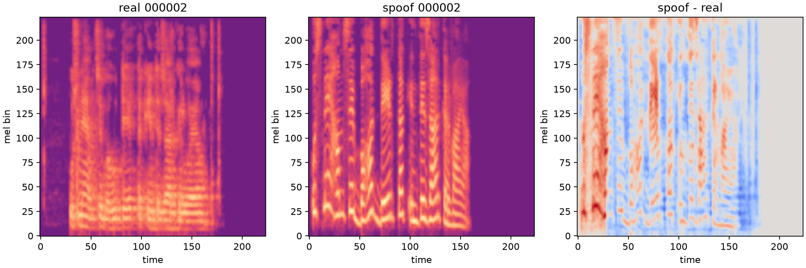

# Working Paper Draft: Transcript-Paired Hindi Deepfake Speech Detection

> **Status (2026-08-09): living partial-results draft.** The transcript-paired E2 system has completed three independent training runs and cross-source evaluation. The count-matched non-paired control and normalization ablation remain outstanding, so causal claims about pairing are intentionally deferred.

> **Writing note:** Keep the final paper clear and direct. Use short sentences,
> explain technical terms when they first appear, and avoid inflated claims.
> Prefer ordinary words when they carry the same technical meaning.

## Title candidates

1. **Beyond Random Splits: Transcript-Paired Training for Cross-Source Hindi Deepfake Speech Detection**
2. **When Source Becomes the Label: Auditing and Reducing Shortcut Learning in Hindi Deepfake Speech Detection**
3. **Transcript-Controlled Training for Source-Robust Hindi Synthetic Speech Detection**
4. **Cross-Corpus Hindi Audio Deepfake Detection under Source and Channel Shift**

The first title is preferred if the planned paired-training study demonstrates a statistically supported cross-source improvement. Otherwise, the second title more accurately reflects the completed factorial and diagnostic evidence.

## Abstract (preliminary; update after confirmatory experiments)

Audio deepfake detectors can score almost perfectly when their training and
test data come from the same dataset. However, they may fail when the audio
comes from a new source. We study this problem for Hindi speech. We use real
speech from Kathbath and Common Voice, and synthetic speech from IndicSynth
and SEA-Spoof. Our early cross-source experiments produced equal error rates
(EERs) between 3.74% and 40.46%. They also showed that the model was learning
differences between datasets, such as silence and recording conditions. We
therefore trained the model with real and fake clips that had the same
transcript. This prevents the words in a clip from becoming a shortcut for
the label. We trained three EfficientNet-B0 models on 3,000 checked
SEA-Spoof transcript pairs. The models were almost perfect on held-out
SEA-Spoof data. On audio from unseen sources, their mean balanced accuracy
was 89.07% (SD 1.15), ROC-AUC was 0.9501 (SD 0.0205), and EER was 10.98%
(SD 3.69). Most errors came from Kathbath: only 39.44% of its real clips were
classified correctly. Accuracy on every other external source was above
98.6%. These results show that matching transcripts does not remove all
dataset-specific effects. A matched experiment without transcript pairing is
still needed to measure how much pairing helps.

## 1. Introduction

Synthetic speech is increasingly natural, creating a need for detectors that distinguish genuine human speech from generated or manipulated audio. A central evaluation difficulty is that the class label often aligns with the source corpus: genuine recordings and synthetic utterances may differ not only in authenticity, but also in microphone characteristics, codec, silence structure, loudness, duration, and preprocessing. A model can consequently perform well by recognizing a dataset or recording chain rather than artifacts of speech synthesis.

This concern is especially important in cross-corpus and comparatively low-resource settings, where a detector may encounter speakers, channels, and synthesis systems absent from training. Hindi provides a useful case study because several genuine- and synthetic-speech sources are available, but their acquisition conditions are heterogeneous. A random split over pooled sources places examples from each source in both training and test partitions and therefore does not measure deployment-like generalization.

Our pilot study demonstrates the severity of this issue. A pretrained EfficientNet-B0 trained on a pooled, label-stratified split of 8,810 clips reached 100% accuracy and 0.0% EER. In contrast, source-held-out experiments over two genuine-source groups and two spoof-source groups produced EERs between 3.74% and 40.46%. The effect was not attributable to one source alone: performance depended on the interaction between the genuine and spoof sources chosen for training. In the worst rotation, the learned embedding represented source identity almost as strongly as the intended genuine/spoof label.

We investigate transcript pairing as a controlled intervention. By training on bona fide and spoofed utterances with identical transcripts, the experimental design prevents linguistic content from being systematically associated with a class. This does not automatically remove channel or synthesis-system cues, so we combine it with source-held-out evaluation and a planned silence/loudness normalization ablation.

The intended contributions of the final paper are:

- a leakage-resistant, source-held-out protocol for evaluating Hindi deepfake speech detection;
- a controlled comparison of transcript-paired and ordinary training using identical model and data budgets;
- a factorial analysis of the interaction between real-speech and synthetic-speech source composition;
- signal-level and embedding-level diagnostics of source shortcut learning; and
- reproducible multi-seed evaluation with per-source metrics, uncertainty estimates, calibration analysis, and appropriate baselines.

At present, the first, third, and diagnostic components have pilot evidence. The controlled paired comparison, normalization intervention, multi-seed analysis, and additional baselines are planned and must be completed before the contribution claims are finalized.

## 2. Related work (citation placeholders)

This section must be completed through a systematic literature search. No bibliographic claims should be added without checking the primary paper.

### 2.1 Synthetic speech and audio anti-spoofing

[Cite foundational ASVspoof challenge papers and the current challenge protocol.] Describe common logical-access attacks, corpus construction, and the distinction between stand-alone countermeasure evaluation and tandem ASV evaluation. Define EER and min-tDCF using the cited protocols.

### 2.2 Spectrogram-based and waveform-based detectors

[Cite original EfficientNet, LCNN anti-spoofing, RawNet2, and relevant recent SSL-based detectors.] Position EfficientNet-B0 as the controlled main architecture rather than the methodological novelty. Discuss the trade-off between image-like time-frequency inputs, handcrafted cepstral features, raw-waveform systems, and pretrained speech representations.

### 2.3 Cross-corpus generalization and shortcut learning

[Cite primary cross-dataset audio deepfake studies.] Summarize evidence that within-corpus random splits overestimate generalization and that codec, channel, silence, language, speaker, and generator artifacts can become shortcuts. Distinguish discrimination from calibration under domain shift.

### 2.4 Content-controlled or paired evaluation

[Search for and cite prior transcript-matched, parallel-data, content-invariant, contrastive, or counterfactual training approaches.] Clearly identify whether transcript pairing itself is novel, an adaptation to Hindi, or chiefly an evaluation control. The final novelty claim must follow this review rather than precede it.

### 2.5 Hindi and multilingual deepfake speech resources

[Cite the official dataset papers/cards for Kathbath, Common Voice, IndicSynth, and SEA-Spoof.] Document language coverage, speakers, recording conditions, generation systems, licenses, and intended splits only after verification from primary sources.

## 3. Data

### 3.1 Corpora used in completed pilot work

The legacy multi-source collection contains genuine Hindi speech from Kathbath (`real`, 3,000 clips), Common Voice male (`real_cv_m`, 750 clips), and Common Voice female (`real_cv_f`, 560 clips), and synthetic speech from IndicSynth (`fake`, 3,000 clips) and SEA-Spoof (`fake_sea`, 1,500 clips). The intended Common Voice female count was 750, but streaming exhausted the available filtered examples at 560. The resulting collection contains 4,310 genuine and 4,500 spoof clips (8,810 total).

The transcript-paired pilot uses Hindi bona fide/spoof pairs from the SEA-Spoof validation split. Pairing is performed by exact transcript field, and matching files share a pair index. The transcript is retained in metadata for verification. This validation-derived collection was selected for pipeline smoke testing, not for the final experiment.

### 3.2 Transcript-paired training corpus

The completed paired dataset uses the SEA-Spoof training split and contains 3,000 transcript-matched Hindi bona fide/spoof pairs (6,000 clips). The audit found 3,000 unique transcript groups, no missing transcripts, no incomplete groups, no duplicate file paths, no missing feature files, and no transcript shared across partitions. Each run assigned 2,400 pairs to training, 300 to validation, and 300 to same-corpus testing (4,800/600/600 clips).

The following leakage checks are required:

- keep all members of a transcript group in one partition;
- keep all examples from a speaker in one partition when valid speaker IDs are available;
- detect exact and near-duplicate audio across partitions;
- report transcript overlap, speaker overlap, duration, sample rate, codec, loudness, and silence statistics by source, class, and split; and
- document dataset licenses and any restrictions on derived-data redistribution.

The current legacy metadata stores `speaker="unknown"` for all sources. Speaker-disjoint claims therefore cannot be made until ingestion records upstream speaker identifiers and the manifests are rebuilt.

## 4. Method

### 4.1 Audio preprocessing and representation

In the current pipeline, audio is converted to mono at 16 kHz, silence is removed using a 30 dB threshold, amplitude is normalized, and clips are padded or truncated to four seconds. Log-mel spectrograms use 128 mel bands, a 1,024-sample FFT and window, a 512-sample hop, and a frequency range of 0--8 kHz. The main configuration resizes features to 224 x 224; the paired smoke configuration uses 128 x 128. Confirmatory comparisons must use one common feature size and identical preprocessing for every treatment.

The paired-feature figure uses the actual stored model inputs rather than a redrawn example. The project inspection script loaded the bona fide and spoof `.npy` arrays for transcript-matched SEA-Spoof pair 000002 and plotted them beside their element-wise signed difference. Because the saved arrays have already been resized to 224 x 224, the plot axes are resized feature-map coordinates rather than seconds and physical frequency values. The difference panel is a visual comparison of the two inputs and must not be interpreted as an explanation of the classifier's decision.

### 4.2 Classifier

The main classifier is ImageNet-pretrained EfficientNet-B0 with an unfrozen backbone, dropout of 0.3, and a two-class output. The completed runs used AdamW (learning rate 3e-4, weight decay 1e-5), cosine scheduling, mixed precision, gradient clipping at 5.0, and validation-F1 checkpoint selection. Exact epoch budgets and early-stopping settings varied between main and smoke configurations; these must be standardized in the controlled experiment.

### 4.3 Transcript-paired training

For each selected transcript, the paired condition contains one bona fide and one spoofed utterance sharing that transcript. Pair membership must remain intact during partitioning. Pairing controls linguistic content at dataset construction time; it is not currently implemented as a pairwise loss. The classifier continues to receive and classify individual spectrograms.

The planned non-paired control will match the paired condition in class counts, model architecture, optimization, preprocessing, and training budget, but will sample bona fide and spoofed examples without enforcing transcript equality. This comparison is necessary to isolate the effect of pairing from sample count and other pipeline differences.

### 4.4 Normalization intervention

A planned 2 x 2 study crosses sampling strategy (ordinary versus transcript-paired) with channel normalization (standard preprocessing versus controlled silence/loudness normalization). The intervention must be specified before running it, including the speech-activity rule and loudness target. It will test whether the observed association between silence statistics and source entanglement is causal rather than merely correlational.

## 5. Experimental protocol

### 5.0 Complete configuration used for the reported experiment

| Component | Fixed setting |
|---|---|
| Training corpus | SEA-Spoof training split, Hindi (`hi`) only |
| Pair construction | 3,000 normalized transcripts; one bona fide and one spoof clip per transcript; 6,000 clips total |
| Partitioning | Transcript-grouped 80/10/10; 4,800 train, 600 validation, 600 same-corpus test; balanced labels; no transcript crosses partitions |
| Audio preprocessing | Mono, 16 kHz, silence removal at 30 dB, peak normalization, zero-padding or truncation to four seconds |
| Feature extraction | Log-mel power spectrogram, 128 mel bands, FFT/window 1,024, hop 512, 0--8 kHz, resized to 224 x 224 |
| Model | ImageNet-pretrained EfficientNet-B0, one input channel, two output classes, dropout 0.3, unfrozen backbone, no BiLSTM |
| Optimization | Cross-entropy loss, AdamW, learning rate 3e-4, weight decay 1e-5, batch size 32, cosine schedule |
| Training control | Maximum 50 epochs, validation-F1 checkpoint selection, early-stopping patience 7, minimum improvement 1e-4, mixed precision on CUDA, gradient clipping 5.0, four workers |
| Independent training seeds | 42, 1337 and 2026; each controls transcript split, model initialization and batch order |
| Same-corpus evaluation | The 600-clip SEA-Spoof test partition belonging to each grouped split |
| External sources | Kathbath Hindi real, Common Voice Hindi male real, Common Voice Hindi female real, IndicSynth Hindi fake |
| External manifests | 100 clips per source, or 400 clips per manifest; sampling seeds 42, 1337 and 2026 for every frozen trained model |
| External-test condition | Identical preprocessing and feature extraction; frozen checkpoint; no retraining or checkpoint selection on external data |
| Decision and metrics | Fixed threshold 0.5; balanced accuracy, accuracy, F1, MCC, ROC-AUC and EER; mean and sample SD across model-training seeds |

The completed condition is transcript-paired training followed by same-corpus and cross-source evaluation. The three evaluation-sampling seeds per model are repeated samples for one frozen model, not additional training runs. Count-matched non-paired training, alternative architectures and preprocessing ablations remain planned; the draft does not present them as completed evidence.

### 5.1 Completed pilot protocols

The pooled pilot used a label-stratified random split, allowing every source to appear in training and test data. It is retained only as an optimistic within-source reference.

The completed cross-source factorial groups genuine speech as Kathbath (A) versus Common Voice (B), and spoof speech as IndicSynth (A) versus SEA-Spoof (B). Each of four models trains and validates on one genuine/spoof source combination and tests on the complementary combination. These are single-run pilot experiments and do not yet include uncertainty estimates.

The publication-scale paired protocol uses an 80/10/10 split grouped by normalized transcript, so every real/spoof pair stays in one partition. Three independent runs use seeds 42, 1337, and 2026. For each trained model, external evaluation uses three deterministic manifests containing 100 clips from each of Kathbath, Common Voice male, Common Voice female, and IndicSynth. The resulting 400-clip manifest is class-imbalanced (300 genuine, 100 spoof), so balanced accuracy, EER, and ROC-AUC receive greater emphasis than raw accuracy. Earlier smoke runs used row-level stratification and are superseded because transcript groups crossed split boundaries.

### 5.2 Planned confirmatory protocol

The confirmatory study will freeze training, validation, and source-held-out test manifests before training. Hyperparameters and the operating threshold will be selected using training and validation data only. Cross-source test data will not be used for model selection or threshold tuning.

The core experiment matrix is:

| System | Sampling | Silence/loudness intervention | Status |
|---|---|---|---|
| E1 | ordinary, count-matched | off | planned |
| E2 | transcript-paired | off | completed (three training seeds) |
| E3 | ordinary, count-matched | on | planned |
| E4 | transcript-paired | on | planned |

Each condition will be run with at least three fixed seeds; five seeds are preferred. The same evaluation clips will be used for paired statistical comparisons. Report per-seed values, mean and standard deviation, and 95% bootstrap confidence intervals for differences between systems.

The primary metric will be EER. Secondary metrics will include ROC-AUC, macro F1, balanced accuracy, false-positive and false-negative rates, confusion matrices, and calibration measures [specify expected calibration error and/or Brier score before analysis]. Results will be separated by source as well as pooled. A fixed deployment threshold selected on validation data will be reported alongside threshold-free metrics. Min-tDCF will be reported only if a valid ASV subsystem, trial protocol, ASV scores, and cost/prior configuration are available; classifier scores alone are insufficient.

### 5.3 Baselines and ablations (planned)

Required baselines are a majority/random reference, EfficientNet-B0 without pairing, and at least one non-EfficientNet detector. LCNN with LFCC or log-spectrogram inputs is the minimum practical architecture baseline. A frozen self-supervised speech encoder with a simple classifier should be added if compute permits. A RawNet2 comparison would require a separate waveform pipeline and should be included only if it can be implemented and tuned fairly.

Planned ablations include pair-count scaling, pretrained versus random initialization, mel-spectrogram versus LFCC where feasible, and controlled removal of silence/loudness normalization. Grad-CAM and paired spectrogram plots will be qualitative diagnostics, not standalone causal evidence.

## 6. Results to date (pilot evidence only)

### 6.1 Pooled random split

On the 8,810-clip pooled dataset, EfficientNet-B0 achieved accuracy 1.0000, F1 1.0000, ROC-AUC 1.0000, and EER 0.0000, reaching this separation by the first epoch and stopping at epoch 8 of 50. Because every corpus occurred on both sides of the split, this is an optimistic within-source result and not evidence of unseen-source generalization.

### 6.2 Source-held-out factorial

| Training genuine source | Training spoof source | Accuracy | F1 | ROC-AUC | EER | Pilot interpretation |
|---|---|---:|---:|---:|---:|---|
| Kathbath | IndicSynth | 0.9612 | 0.9633 | 0.9939 | 0.0374 | strongest transfer |
| Common Voice | IndicSynth | 0.6711 | 0.1581 | 0.8165 | 0.2325 | ranking partly survives; threshold-dependent performance is poor |
| Common Voice | SEA-Spoof | 0.5027 | 0.0113 | 0.8761 | 0.2160 | severe calibration shift at threshold 0.5 |
| Kathbath | SEA-Spoof | 0.4211 | 0.3663 | 0.6273 | 0.4046 | ranking and calibration both degrade |

The spread from 3.74% to 40.46% EER shows that cross-source performance is strongly dependent on the joint training-source composition. In the Common Voice plus SEA-Spoof rotation, the model assigned almost every unseen clip to the genuine class at a 0.5 threshold, despite ROC-AUC of 0.8761; this distinguishes calibration failure from complete loss of ranking information. By contrast, the Kathbath plus SEA-Spoof rotation produced ROC-AUC 0.6273, indicating degradation of ranking itself.

### 6.3 Signal and embedding diagnostics

The per-source signal audit sampled 300 processed clips from each source. Mean trailing-zero ratios were 0.0144 (IndicSynth), 0.0779 (SEA-Spoof), 0.0365 (Kathbath), 0.2810 (Common Voice female), and 0.3591 (Common Voice male). Mean frame-level silence ratios followed a similar source-dependent pattern: 0.0689, 0.1120, 0.1270, 0.3310, and 0.3965, respectively. These overlapping but systematic differences are plausible shortcuts; they do not by themselves establish causality.

Embedding analysis used the same balanced sample of 2,000 clips (400 per source) for every checkpoint. It compared silhouette scores for source identity and binary label:

| Model/rotation | Source silhouette | Label silhouette | Source/label ratio | Cross-source EER |
|---|---:|---:|---:|---:|
| pooled main | 0.1469 | 0.4608 | 0.319 | not applicable (pooled EER 0.0000) |
| Kathbath + IndicSynth | 0.1436 | 0.2810 | 0.511 | 0.0374 |
| Common Voice + IndicSynth | 0.1492 | 0.2746 | 0.543 | 0.2325 |
| Common Voice + SEA-Spoof | 0.1417 | 0.2224 | 0.637 | 0.2160 |
| Kathbath + SEA-Spoof | 0.1691 | 0.1769 | 0.956 | 0.4046 |

The worst-generalizing rotation has nearly equal source and label silhouette scores. Across the four rotations, higher source/label entanglement broadly accompanies higher cross-source EER. This is correlational evidence; the planned normalization intervention is required for a stronger causal claim.

### 6.4 Transcript-paired smoke results

The verified leakage-safe run contains 500 pairs represented by 1,000 rows and 250 unique normalized-transcript groups. Grouped partitioning assigned 678 rows to training, 166 to validation, and 156 to testing, with zero transcript groups crossing split boundaries. On the 156-row test set, the model obtained accuracy 0.929487, precision 0.913580, recall 0.948718, F1 0.930818, ROC-AUC 0.991124, and EER 0.051282. Its confusion matrix was `[[71, 7], [4, 74]]`, with rows denoting actual classes and columns predicted classes in the pipeline's real/fake order.

An earlier 500-pair result reported accuracy 0.9867, F1 0.9865, ROC-AUC 1.0000, and EER 0.0000. Audit showed that its row-stratified split placed 164 transcript groups across more than one partition. That evaluation was therefore affected by transcript leakage and is superseded by the grouped-split result above. The lower leakage-safe score is the appropriate same-source pilot estimate.

This remains a single-run pilot drawn entirely from SEA-Spoof validation. It demonstrates that the pipeline learns a strong same-source boundary without cross-split transcript overlap, but it does not establish cross-source robustness or a benefit over count-matched non-paired training.

The 500-target checkpoint was first evaluated on 60 randomly sampled clips from sources absent from its training data. Per-source accuracies were 0.6000 for Kathbath, 0.8667 for Common Voice male, 1.0000 for Common Voice female, and 0.9333 for IndicSynth; overall accuracy was 0.8500 (51/60). This single-seed spot check is too small and insufficiently controlled for a paper claim. In particular, 8 of 20 sampled Kathbath clips were misclassified as spoof.

A subsequent exploratory cross-source protocol evaluated the same single trained checkpoint on three independently sampled evaluation manifests, each containing 100 clips from each unseen source (400 clips per seed). Across these three evaluation seeds, mean accuracy was 0.811667 (SD 0.027424), balanced accuracy 0.843333 (SD 0.015899), F1 0.707430 (SD 0.029153), ROC-AUC 0.929567 (SD 0.007015), EER 0.156667 (SD 0.013017), and Matthews correlation coefficient 0.610414 (SD 0.037549). Exact manifests and per-example predictions are stored in `outputs/smoke_seaspoof_paired/cross_source_protocol.json`.

These dispersions quantify sensitivity to which evaluation clips are sampled; they are not independent-training-seed uncertainty because all three manifests were scored by one trained model. This historical smoke result has now been superseded by the publication-scale experiment below.

### 6.5 Publication-scale transcript-paired experiment

Three EfficientNet-B0 models were independently trained with seeds 42, 1337,
and 2026 on the 3,000-pair SEA-Spoof training corpus. The protocol audit
passed for every run. Same-corpus test accuracy ranged from 0.9950 to 1.0000,
showing that the leakage-safe paired task is nearly perfectly separable
within SEA-Spoof. This result is an in-domain upper bound, not evidence of
deployment-like generalization.

Each model was then evaluated on three deterministic external manifests with
100 clips per source. The values below first average the three sampling
manifests for each model; the final row reports mean and sample standard
deviation across the three independently trained models.

| Training seed | Accuracy | Balanced accuracy | F1 | ROC-AUC | EER | MCC |
|---:|---:|---:|---:|---:|---:|---:|
| 42 | 0.8625 | 0.9039 | 0.7825 | 0.9625 | 0.0922 | 0.7210 |
| 1337 | 0.8242 | 0.8828 | 0.7400 | 0.9615 | 0.0850 | 0.6706 |
| 2026 | 0.8400 | 0.8856 | 0.7534 | 0.9264 | 0.1522 | 0.6827 |
| **Mean ± SD** | **0.8422 ± 0.0193** | **0.8907 ± 0.0115** | **0.7586 ± 0.0217** | **0.9501 ± 0.0205** | **0.1098 ± 0.0369** | **0.6914 ± 0.0264** |

Performance was sharply source-dependent:

| External source | Label | Mean accuracy across models | Range across all manifests |
|---|---|---:|---:|
| Kathbath | genuine | 0.3944 | 0.28–0.53 |
| Common Voice male | genuine | 1.0000 | 1.00–1.00 |
| Common Voice female | genuine | 0.9867 | 0.97–0.99 |
| IndicSynth | spoof | 0.9878 | 0.95–1.00 |

Thus the aggregate domain gap is overwhelmingly driven by Kathbath genuine
speech being classified as spoof. Transcript control does not remove this
failure, which is consistent with the earlier channel/silence confound
analysis. The high ROC-AUC alongside lower fixed-threshold F1 also indicates
that ranking and operating-point calibration should be analyzed separately.
These results establish the E2 system's performance but do not establish an
improvement caused by transcript pairing; that inference requires the E1
count-matched non-paired control on identical external manifests.

## 7. Planned final tables and figures

1. **Dataset audit:** counts, speakers, transcripts, duration, format, loudness, and silence statistics by corpus/class/split.
2. **Main controlled comparison:** E1--E4 cross-source EER, ROC-AUC, macro F1, balanced accuracy, and calibration, reported as mean +/- standard deviation and 95% confidence intervals.
3. **Per-source generalization:** each held-out genuine corpus and spoof generator reported separately.
4. **Architecture baselines:** EfficientNet-B0, LCNN, and [SSL baseline if completed] under the same manifests.
5. **Pair-count ablation:** performance versus number of transcript pairs.
6. **Factorial pilot/context table:** the four legacy source rotations, clearly marked as single-run evidence if not repeated.
7. **Confound table:** silence, padding, RMS, duration, codec, and sample-rate distributions.
8. **Embedding figure:** label- and source-colored projections plus source/label separability statistics.
9. **Calibration figure:** reliability curves and score distributions by source at the validation-selected threshold.
10. **Error analysis:** representative false accepts and false rejects, including Kathbath failures, with qualitative Grad-CAM caveats.

## 8. Discussion (provisional)

The completed evidence supports four conclusions. First, pooled random and same-corpus splits can dramatically overstate performance. Second, cross-source generalization is asymmetric and depends on source composition. Third, poorer transfer is associated with source-dependent signal statistics and source-encoding representations. Fourth, transcript content control alone does not eliminate domain sensitivity: the publication-scale paired detector transfers almost perfectly to Common Voice and IndicSynth but rejects most Kathbath genuine speech.

It does not yet support the central intervention claim that transcript pairing improves cross-source generalization. Pairing controls transcript content, but channel, speaker, generator, and preprocessing artifacts may remain. The final discussion must therefore depend on the controlled E1-versus-E2 comparison and its confidence interval. If E2 improves cross-source performance and reduces source-probe separability, the evidence will support pairing as a useful mitigation. If same-source metrics improve without cross-source benefit, the result will instead show that content control alone is insufficient.

## 9. Limitations

- The older source-held-out factorial remains a single-run pilot; the publication-scale paired evaluation now includes three independently trained models but no completed non-paired comparator.
- Existing speaker metadata is unusable (`unknown` for every clip), preventing verified speaker-disjoint splitting.
- The paired smoke data remains a historical validation-split pilot. The publication-scale experiment uses SEA-Spoof train with 3,000 audited transcript groups.
- The publication-scale external evaluation uses three training seeds and three sampled manifests per model. Sampling manifests overlap and are not a substitute for one fixed, exhaustive external test set.
- Current evidence for silence/channel shortcuts is correlational. Silence trimming and amplitude normalization are already present, but residual source differences remain; a preregistered intervention is required.
- Dataset and generator coverage is limited. Conclusions may not generalize to other languages, codecs, real-world replay conditions, or future synthesis systems.
- EfficientNet-B0 may not represent the strongest contemporary detector. Architecture baselines are needed to show whether conclusions persist beyond one model family.
- EER and ROC-AUC do not alone characterize deployment risk. Threshold calibration and asymmetric error costs must be reported.
- Min-tDCF cannot be computed responsibly without a compatible ASV system and protocol.

## 10. Ethics and responsible use

The intended use is defensive detection and scientific evaluation of synthetic Hindi speech. Dataset licenses, consent conditions, and permitted uses must be verified and documented before publication or release. Audio and metadata should not be redistributed unless licenses explicitly allow it. Speaker identifiers, where recovered, should be stored only as needed for split integrity and handled according to dataset terms.

Performance disparities should be examined across available speaker and recording attributes, while acknowledging that current sex labels from source subsets are not a substitute for a broader fairness analysis. False positives can wrongly classify genuine speakers as deceptive, while false negatives can admit synthetic attacks; both harms should be reported by source and operating threshold. The detector should not be presented as proof that a person acted deceptively, nor deployed as a sole decision-maker in high-stakes settings.

Releasing fixed manifests, hashes, preprocessing settings, and aggregate features can support reproducibility without necessarily redistributing restricted speech. Model release should include a model card describing training sources, known domain failures, intended use, and limitations.

## 11. Reproducibility checklist

- [ ] Freeze and version all train/validation/test manifests.
- [ ] Record exact dataset revisions, access dates, filters, and licenses.
- [ ] Populate and audit transcript and speaker identifiers.
- [ ] Run duplicate and near-duplicate checks across splits.
- [ ] Use identical preprocessing and feature dimensions across controlled systems.
- [ ] Record configuration, code revision, environment, hardware, and random seed for every run.
- [ ] Save per-example scores and labels, not only aggregate metrics.
- [ ] Derive tables programmatically from immutable result files.
- [x] Run and report three independent training seeds for the 3,000-pair E2 system.
- [x] Save three evaluation manifests and per-example scores for each trained E2 model.
- [ ] Select thresholds using validation data only.
- [x] Supersede the row-stratified paired-smoke result after verifying 164 cross-split transcript groups; use only the grouped-split pilot result, which has zero cross-split transcripts.
- [ ] Separate exploratory analyses from confirmatory tests in the manuscript.

## 12. Conclusion (provisional)

The models were almost perfect when training and testing both used
SEA-Spoof. Their performance dropped on data from other sources. Across three
trained models, cross-source EER was 10.98% ± 3.69% and ROC-AUC was 0.9501 ±
0.0205. The problem was concentrated on Kathbath. The models handled Common
Voice and IndicSynth well but classified most real Kathbath clips as fake.
Matching transcripts therefore does not remove every dataset-specific cue.
The next experiment must compare this system with an equally sized system
trained without transcript pairing. The normalization experiment will then
test whether silence and recording-level differences explain the Kathbath
errors.

## References (to be populated from verified primary sources)

- [ASVspoof challenge and metric protocol]
- [EfficientNet]
- [LCNN for audio anti-spoofing]
- [RawNet2]
- [Relevant self-supervised speech detector baseline]
- [Cross-corpus audio deepfake generalization studies]
- [Kathbath dataset]
- [Common Voice dataset/version]
- [IndicSynth dataset]
- [SEA-Spoof dataset]
